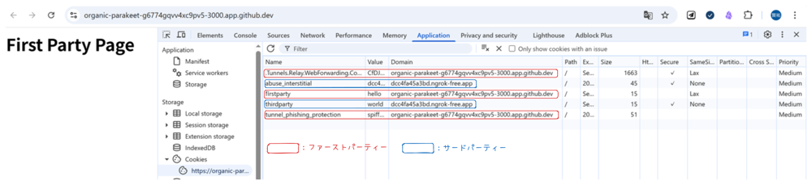

## はじめに

広告収益はWEBサービスの重要な資金源です。ユーザーの趣向に合わせて効果的に広告を表示するためには、それまでユーザーがどのようなサイトに訪問したのか、広告配信ネットワークが把握する必要があります。こうした目的によく使われるのが「サードパーティCookie」です。

しかし近年GDPRなどの規制強化に伴い、サードパーティーCookieがブラウザによって制限され始めています。

これにより（とばっちりを受けるような形で）広告のみならず、一般的な Web アプリケーションの機能も一部影響を受ける可能性があります。
そもそものサードパーティCookieの基礎を理解して、こうした動きに自身のサービスが追従できるようになりましょう！

## 課題1-1 サードパーティCookieとファーストパーティCookieの違い

- ファーストパーティCookie
  - 発行元：ユーザーが訪問しているサイトのドメイン
  - 用途：そのユーザの行動内容の保存
  - 範囲：発行元のWebサイトにのみ使われる
- サードパーティCookie
  - 発行元：訪問しているWebサイトとは異なるドメイン
  - 用途：広告、Webページ訪問履歴の集計
  - 範囲：複数のWebサイトを横断して追跡される

→ ユーザがアクセスしたサイトとは別ドメインから気づかぬうちに発行・送信しているcookieが「サードパーティーCookie」となる。

## 課題1-2

サードパーティ Cookie を用いて広告配信ネットワーク（例えばGoogle AdSense など）がどのようにユーザの訪問履歴を把握しているのか、説明してください。

### 1: トラッキングの開始

- サイト上に埋め込まれたスクリプトなどを介して広告配信サーバからcookieが発行される
- cookie内にはユーザが特定できる固有IDが含まれている

### 2: サイトを横断した追跡

- 同じ広告配信サーバを利用している別のウェブサイトを訪問すると、ブラウザは1.で設定されたcookieを広告配信サーバに送信する
- 広告配信サーバーはユーザからcookieを受け取り、どのユーザがどのサイトをいつ利用したのか、データを蓄積する

### 3: 広告配信の利用

- 広告配信サーバは、ユーザの行動履歴をもとに、類似性の高い広告を表示する

## 課題1-3

そもそもサードパーティーCookieはどのように生成されるのでしょうか？画像埋め込みやスクリプト埋め込みなど、様々な手法
を説明してください。

### 1: scriptタグの埋め込み

サイト内に、広告配信サーバへリクエストを送信するscriptタグを埋め込む

### 2: iframeタグの埋め込み

サイト内に別ドメインのiframeを埋め込み、iframe内のドメインのcookieを発行できるようにする

### 3: imgタグの埋め込み

トラッキングピクセルやウェブビーコンと呼ばれる、1*1ピクセル程度の小さな画像を埋め込む

## 課題1-4

サードパーティCookieの扱いはブラウザによってどのような差があるのでしょうか？（特にsafariは他のブラウザと挙動が異なるので、ぜひ調べてみてください！）

### Safari: 完全にブロック

サードパーティーCookie規制に最も早く着手したブラウザ。トラッキング防止機能とされるITPを導入することでサードパーティーCookieを完全にブロックしている。

また、ファーストパーティーCookieに対しても有効期間を強制的に短くするなどといった対応をとるようにしている。

> 2019年4月のITP2.2では、JavaScriptタグを用いたトラッキング目的のファーストパーティCookieの有効期限を24時間に制限しました。また、2023年4月のiOS 16.4では、WebサーバーとタグサーバーのIPアドレスレンジが異なる場合、サーバーサイドのファーストパーティCookieであっても有効期限を7日間に制限しています。
> 
>[AURIQ - Cookie規制時代、ファーストパーティCookieのアクセス解析への活かし方](https://www.auriq.co.jp/blog/gdpr-analytics-1stparty-cookies/)

### Firefox: デフォルトでブロック

Firefoxの設定機能としてTotal Cookie Protectionなどを追加し、サードパーティーcokkieがデフォルトでブロックされるようになっている

参考

- [標準モードでの包括的 Cookie 保護の導入](https://support.mozilla.org/ja/kb/introducing-total-cookie-protection-standard-mode)
- [デスクトップ版 Firefox の強化型トラッキング防止](https://support.mozilla.org/ja/kb/enhanced-tracking-protection-firefox-desktop) 

### Edge: デフォルトでブロック

Edgeの設定機能として追跡防止機能が追加されており、「Basic」「Balance」「Strict」を選択できるようになっている。

デフォルトは「Balance」が利用され、サードパーティーCookieの利用は基本的に制限されている

参考：[Microsoft Edge での追跡防止](https://learn.microsoft.com/ja-jp/microsoft-edge/web-platform/tracking-prevention)

### Chrome: 利用可能

現在はデフォルトで有効。

Google側の方針として、代替技術として「Privacy Sandbox」を導入し、2022年までにサードパーティーCookie廃止を予定していたが、数度にわたる延期の末、2024年7月にこの声明は撤回されている。

参考：[Zenn - Google がサードパーティクッキー廃止を撤回したので経緯をまとめてみた](https://zenn.dev/immedio/articles/edc21aece4f8da)

### ユーザのプライバシー保護に関する法律

- GDPR（EU一般データ保護規則）: 2018年にEUで施行されたこの法律は、個人データの処理と移転に関して非常に厳しいルールを定めました。企業がユーザーデータを収集・利用する際には、ユーザーからの明確な同意を得ることが義務付けられ、違反した場合には莫大な制裁金が科されます。
- CCPA（カリフォルニア州消費者プライバシー法）: カリフォルニア州で施行された法律で、消費者が自分の個人情報がどのように収集・使用されているかを知る権利や、その削除を要求する権利を認めています。

[Qiita - クッキー同意バナーが表示されるようになった背景](https://qiita.com/kodack/items/0441709102c6de18b0bf)

## 課題1-5

ドメインは同一で、ポートが異なるCookieはファーストパーティCookieでしょうか？サードパーティCookieでしょうか？（hoge.com:8080とhoge.com:8081など）

ファーストパーティCookie として扱われる。

### 理由

ファーストパーティー、サードパーティーを分ける基準は、「ドメインが一致するか」となる。

RFC6265内ではドメインが同じであれば、ポート番号が違っても同じCookieとして扱われるように定義されている。

## 課題2

ページの読み込みと同時に、ファーストパーティCookieと、サードパーティCookieが設定されるようなWEBサイトを作成してみましょう。


https://github.com/praha-kmishima/praha-third-party-cookie

scriptタグを埋め込んで、サードパーティーcookieが設定されるようにする。

### 1: ファーストパーティーCookie配信サーバ

```ts
const app = new Hono()

const thirdPartyScriptUrl = 'https://organic-parakeet-g6774gqvv4xc9pv5-8000.app.github.dev/script.js'

app.get('/', (c) => {
  c.header('Set-Cookie', 'firstparty=hello; Path=/; SameSite=Lax') // ファーストパーティーcookieをセット
  return c.html(`
    <html>
      <body>
        <h1>First Party Page</h1>
        /* ↓ 別ドメインへと通信する */
        <script src="${thirdPartyScriptUrl}"></script>
      </body>
    </html>
  `)
})
```

### 2: サードパーティーCookie配信サーバ

```ts
const app = new Hono()

// リクエストに対してSet-Cookieを含めたレスポンスを返す
app.get('/script.js', (c) => {
  c.header('Set-Cookie', 'thirdparty=world; Path=/; SameSite=None; Secure')
  c.header('Content-Type', 'application/javascript')
  return c.body('console.log("third-party script loaded");')
})
```

### 動作確認

ファーストパーティーCookie配信サーバにアクセスした。

DevToolを確認すると、Hono側でSet-Cookieに指定した、`firstparty: hello`, `thirdparty: world`の2つのcookieがセットされていることが確認できた。

(なお、Github Codespaceで動作確認したところ、`abuse_interstitial`,`tunnel_phishing_protection`などcodespace側で設定されるcookieも付与されていた)

